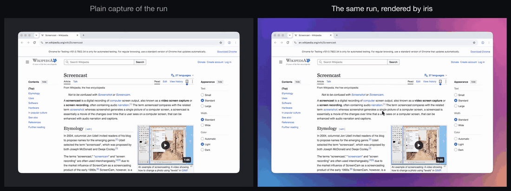
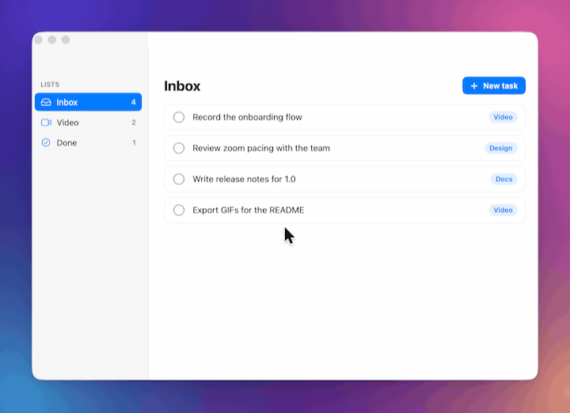

<div align="center">

# Iris

**Screen recordings that zoom on what matters, for people and for AI agents.**

A small macOS command-line recorder. It renders the kind of video you would otherwise edit by
hand: backdrop, smooth pointer, automatic zoom, captions. It works when nobody touches the mouse.

[](https://github.com/Dylan-Nihilo/iris/actions/workflows/ci.yml)
[](LICENSE)


[English](README.md) · [简体中文](README.zh-CN.md)



<sub>One Playwright run, recorded once, behind other windows. Left: the recording with nothing
added. Right: what iris renders from it. Nobody touched the mouse.<br>
Pages from Wikipedia ("Screencast", "Iris (anatomy)"), CC BY-SA 4.0; eye photograph by
Rapidreflex, CC BY-SA 4.0.</sub>

</div>

## Why

Polished screen recorders decide where to zoom from the mouse clicks the system saw. An agent
that drives an interface through Playwright, CDP or accessibility actions never touches the
mouse, so those tools have nothing to zoom on, and the video is a flat, distant picture of a
window in which things happen by themselves.

Iris takes the other route. The agent says where it is about to act:

    iris mark --kind click --x 640 --y 412 --caption "Open the settings"

and the camera, the pointer, the click ring and the caption follow from that. When the real
pointer is used, by a person or by computer use, iris sees it and needs no declarations.

## Features

- **Automatic zoom** on every action, declared or observed, with a camera that arrives before
  the action and pulls back afterwards.
- **A pointer drawn at render time**: it glides where the real one jumped, and exists where
  there was no real one at all. Click rings included.
- **Captions, shortcut keys, fast-forward**: say what a step is for, show `⌘ ⇧ P` when a
  shortcut is pressed, run through a slow stretch at 8× with a badge.
- **Waiting disappears**: stretches where the picture stands still are cut, and each declared
  action is moved to the moment the picture answers, so an agent's thinking time never shows.
- **Unattended by design**: every command returns JSON at once; the recorder runs in the
  background; `iris run -- your-script` records a whole script and renders it.
- **Leaves your machine alone**: a window is recorded by itself, behind other windows or on
  another Space, without the real mouse or keyboard.
- **MP4 and GIF**, gradient or image backdrops, rounded corners, shadow, motion blur.
- **A skill for coding agents**: Claude Code and Codex learn the workflow from one file,
  including how to check their own result.
- One Swift package, **no dependencies** beyond the system frameworks (`ffmpeg` only for GIF).

## Install

Requires macOS 14 or later. With Homebrew:

    brew install Dylan-Nihilo/tap/iris

The full name matters: plain `iris` is another program in Homebrew. Or take the binary of the
[latest release](https://github.com/Dylan-Nihilo/iris/releases/latest), which runs on Apple
silicon and Intel:

    mkdir -p ~/.local/bin
    curl -L https://github.com/Dylan-Nihilo/iris/releases/latest/download/iris-macos-universal.tar.gz \
      | tar -xz -C ~/.local/bin iris

Or build it, with Swift 6.1 or later (Xcode 16.4 or later):

    git clone https://github.com/Dylan-Nihilo/iris.git && cd iris
    Scripts/install.sh                 # builds and installs ~/.local/bin/iris

The release binary is not notarised. Installed by Homebrew or `curl` it runs as it is; a copy
downloaded with a browser needs `xattr -d com.apple.quarantine iris` once.

Then teach your coding agent to record:

    iris skill --claude                # writes ~/.claude/skills/iris-recording/SKILL.md
    iris skill --codex                 # the same for Codex

The application that launches `iris` (your terminal, or the agent's desktop app) needs the
**Screen & System Audio Recording** permission in System Settings. Posting real mouse or
keyboard events, as computer use does, needs **Accessibility** as well. Then:

    iris doctor        # permissions, ffmpeg, whether a recording is running

## Quick start

See it work before you write anything. In a clone of the repository,

    Scripts/demo.sh

opens a small window that operates itself, declares each of its actions the way an agent
would, and writes `samples/demo/demo.mp4` and `demo.gif`. The window never takes the keyboard.



Record something of your own:

    iris windows                                   # what can be recorded
    iris start --app "Notes" --name onboarding     # returns at once; records in the background
    iris mark --kind click --x 640 --y 412         # declare an action, then perform it
    iris mark --kind type  --rect 320,690,640,44   # the camera follows text into a field
    iris mark --kind focus --rect 300,120,700,420  # show a result
    iris stop --render --format both --out ~/Movies/onboarding
    iris sheet                                     # one image of the whole video, to check it

Or hand iris the whole script:

    iris run --app "Notes" --render --format both --out ~/Movies/demo -- node demo.mjs

Every command prints JSON and acts on the most recent session unless a session directory is
given. `iris help` lists every option; `iris guide` is the complete how-to that agents read.

## Using it from an agent

The skill in [`skills/iris-recording`](skills/iris-recording/SKILL.md) is what `iris skill`
writes: the text of `iris guide` under a header that says when to load it. With it installed,
an agent asked to "record a video of X" knows the workflow.

| The agent acts through | What iris goes by |
| --- | --- |
| Playwright, CDP, DOM, accessibility actions | The declared marks. Iris draws its own pointer gliding from one declared click to the next and ignores the real mouse, so the machine stays usable meanwhile. |
| The real pointer (computer use, cliclick, CGEvent) | What it saw: it zooms on every click, turns the pointer's jumps into glides, and follows typed text that appears out of view. Marks are optional. |

Coordinates can be screen points, points inside the recorded window, or 0 to 1 across the
picture (`--space screen|window|norm`). `--ref WIDTHxHEIGHT` takes numbers measured in a
screenshot or viewport of another size, so computer-use and Playwright coordinates go in
unchanged:

```js
const box = await page.locator('#send').boundingBox();
const { width, height } = page.viewportSize();
execFileSync('iris', ['mark', '--space', 'window', '--ref', `${width}x${height}`, '--kind', 'click',
  '--rect', `${box.x},${box.y},${box.width},${box.height}`, '--caption', 'Send the message']);
await page.click('#send');
```

A declared action does not have to be performed at once. The render moves it to the moment
the picture actually answers and cuts the waiting.

## Telling the viewer what happens

| To | Command |
| --- | --- |
| Say what an action is for | `iris mark --kind click --x X --y Y --caption "Open the settings"` |
| Say something about what is on screen | `iris caption "The build takes about a minute"` |
| Show a keyboard shortcut | `iris keys cmd+shift+p`, then press it |
| Run through a slow stretch | `iris speed 8` … `iris speed 1` |

A caption stays as long as it takes to read (Chinese and Japanese are counted by character),
gives way to the next one, and arrives with the camera when it belongs to an action.

## Rendering

Rendering is separate from recording and never touches it; render as often as you like.

    iris render --format mp4|gif|both --out FILE --width 1920 --fps 60
                --background aurora|#101418|FILE|wallpaper --padding 0.06 --aspect 16:9
                --zoom 2.0 | --no-zoom   --cursor-size 1.5 | --no-cursor   --no-clicks
                --idle-max 1.5 | --keep-idle   --gif-width 800 --gif-fps 15
                --no-captions   --no-keys   --no-speed   --caption-size 1.0

Backdrops: `aurora`, `ocean`, `sunset`, `meadow`, `graphite`, `paper`, `midnight`, `peach`, a
`#hex` colour, an image file, or `wallpaper` for the desktop picture.

- `iris plan` prints what the render will do: zooms, captions, the stretches that are kept.
- `iris frames --at 3.5,8` saves full-size frames at those moments of the video.
- `iris mark --at SECONDS ...` adds or corrects a focus point after the fact; `iris caption`
  and `iris keys` take `--at` too.
- `--focus visual` zooms on what changes in the picture, for a recording nobody declared
  anything in.

## Commands

| Command | What it does |
| --- | --- |
| `iris windows` | Lists the windows that can be recorded |
| `iris start` | Begins recording a window, a display or a region, in the background |
| `iris mark` | Declares where the viewer should look: `click`, `type`, `focus`, `wide` |
| `iris caption` · `iris keys` · `iris speed` | Words, shortcut keys, and pace |
| `iris pause` · `iris resume` | Leaves a stretch out |
| `iris stop` | Finishes; with `--render`, produces the video |
| `iris run -- command` | Records while a command runs, then stops and optionally renders |
| `iris render` | Composes the video from a session |
| `iris plan` · `iris frames` · `iris sheet` | Ways to look at a render before, and after |
| `iris status` · `iris doctor` | The current recording; whether this machine can record |
| `iris guide` · `iris skill` | The how-to agents read; the same as a skill for Claude Code or Codex |
| `iris help` · `iris version` | Every option; the version |

## How it works

    iris start ──► recorder (background process)          iris render
                   ScreenCaptureKit → raw.mov (HEVC)       Timeline  what happened, in recording time
                   input.jsonl    pointer, clicks, keys    ZoomPlan  where the camera should be
                   changes.jsonl  where the picture moved  CursorTrack / CameraTrack  springs
    iris mark ───► marks.jsonl    what the agent declared  Compositor (Core Image) → MP4 → GIF

A session is a directory, by default `~/Movies/Iris/<time>-<name>`. The recording has no
pointer in it; the pointer of the video is drawn at render time. That is what allows a glide
where the real pointer jumped, and a pointer where there was none.

- Stretches where the picture stands still are cut down to `--idle-max` seconds.
- Camera and pointer are critically damped springs: nothing overshoots, nothing starts or
  stops abruptly.
- The decisions about what the viewer sees work on a plain `Timeline`, so they are unit-tested
  without recording anything.

What decides the look sits in a few small places, each number with a comment:
[`ZoomPolicy`](Sources/IrisCore/Render/Plan.swift) (how close, how early, how long),
[`MotionPolicy`](Sources/IrisCore/Render/Motion.swift) (how fast the camera and pointer move),
[`Overlays`](Sources/IrisCore/Render/Overlays.swift) (how long words stay) and
[`Lettering`](Sources/IrisCore/Render/Lettering.swift) (how they are drawn).

## Privacy

- Iris works entirely on your machine. It makes no network requests and uploads nothing.
- It never reads which keys are pressed. It only counts that a key went down, to know that
  typing is going on. A shortcut appears in a video only when it was declared with `iris keys`.
- Input is read from the window server's counters, without an event tap.
- A window target records that application alone; other windows are not in the picture.

## Limits

- macOS only. No audio, no webcam.
- One recording at a time.
- A window on another Space, or behind a full-screen application, is recorded by itself:
  menus and dialogs that open as separate windows are missing, the real pointer is not
  sampled, and an application may stop drawing while out of view (Chromium and Electron do;
  `iris guide` shows a preload that keeps them drawing). `iris start` says so in a `note`.
- The recorded window must not be moved or resized while recording.
- Real keystrokes are attributed to the recording only while the recorded application is the
  frontmost one.

Iris is young (0.1). The declared-marks path and the real-pointer path are exercised end to
end by `Scripts/demo.sh` and `IRIS_DEMO_REAL=1 Scripts/demo.sh`. Paths that have had little
exercise so far: `--whole-screen`, real keystrokes typed by an agent, and `--focus visual`.
[Reports](https://github.com/Dylan-Nihilo/iris/issues) are welcome.

## Roadmap

- A signed and notarised release binary
- Audio: narration track, system sound
- Editing a finished plan by hand (move a zoom, retime a caption) without marks
- Portrait and square layouts for social clips

## Contributing

Issues and pull requests are welcome.

    swift build
    swift test                        # no screen access needed
    Scripts/demo.sh                   # end to end; needs the Screen Recording permission
    Scripts/install.sh --skill-file   # after changing the guide in Sources/IrisCore/Support/Guide.swift

[`AGENTS.md`](AGENTS.md) has the layout and the conventions, for people and for coding agents
alike. A change to what the viewer sees comes with a test, and with a look at a render.

## Acknowledgements

The look iris aims for was set by [Screen Studio](https://screen.studio). Iris is an
independent project and is not affiliated with it.

## License

[MIT](LICENSE)
