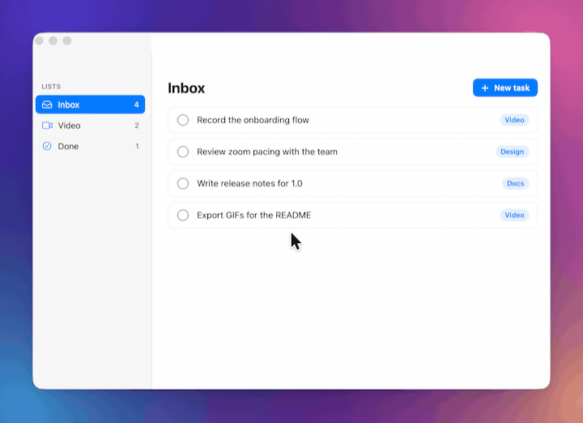

<div align="center">

# Iris

**会自动聚焦重点的录屏工具，给人用，也给 AI agent 用。**

一个小巧的 macOS 命令行录屏工具。它直接渲染出原本需要手工剪辑的成片：背景、平滑的鼠标指针、
自动缩放、字幕。没有人碰鼠标时，它照样工作。

[](https://github.com/Dylan-Nihilo/iris/actions/workflows/ci.yml)
[](LICENSE)


[English](README.md) · [简体中文](README.zh-CN.md)



<sub>全程无人操作，由 iris 自己录制并渲染：<code>Scripts/demo.sh</code></sub>

</div>

## 为什么做这个

精致的录屏工具靠系统捕捉到的鼠标点击来决定往哪里缩放。而通过 Playwright、CDP 或辅助功能接口
操作界面的 agent 从不碰鼠标，这些工具就没有东西可以聚焦，录出来只是一个远远的、平铺的窗口，
里面的东西自己在动。

Iris 走另一条路。agent 在动手之前先说一声要在哪里操作：

    iris mark --kind click --x 640 --y 412 --caption "打开设置"

镜头、指针、点击光圈和字幕都由此而来。如果用的是真实鼠标（人，或者 computer use），iris 自己
看得到，不需要声明。

## 特性

- **自动缩放**：每一个动作，无论是声明的还是观察到的，镜头都先一步到位，之后再拉远。
- **指针在渲染时绘制**：真实指针跳变的地方它平滑滑过，没有真实指针的地方它照样存在，带点击光圈。
- **字幕、快捷键、快进**：说明这一步在做什么；按下快捷键时显示 `⌘ ⇧ P`；慢的段落以 8× 带角标快进。
- **等待自动消失**：画面静止的段落被剪掉，每个声明的动作被挪到画面真正响应的那一刻，
  agent 思考的时间不会出现在视频里。
- **为无人值守而设计**：每条命令立即返回 JSON；录制在后台进行；`iris run -- 你的脚本`
  录下整个脚本并渲染。
- **不打扰你的电脑**：窗口被单独录制，可以在其他窗口后面或另一个桌面空间，不占用真实的鼠标和键盘。
- **MP4 与 GIF**，渐变或图片背景，圆角、阴影、运动模糊。
- **给编码 agent 的 skill**：Claude Code 和 Codex 从一个文件学会整个流程，包括如何检查自己的成片。
- 一个 Swift package，除系统框架外**零依赖**（只有 GIF 输出需要 `ffmpeg`）。

## 安装

需要 macOS 14 或更高版本，以及 Swift 工具链（Xcode 15 或更高）。

    git clone https://github.com/Dylan-Nihilo/iris.git && cd iris
    Scripts/install.sh                 # 构建并安装到 ~/.local/bin/iris
    Scripts/install.sh --claude-skill  # 同时为 Claude Code 链接录制 skill
    Scripts/install.sh --codex-skill   # 同时为 Codex 链接

启动 `iris` 的应用（你的终端，或 agent 的桌面应用）需要在系统设置中获得**录屏与系统录音**权限。
像 computer use 那样发送真实的鼠标键盘事件，还需要**辅助功能**权限。然后：

    iris doctor        # 权限、ffmpeg、是否有录制正在进行

## 快速开始

先看它跑起来：

    Scripts/demo.sh

会打开一个自己操作自己的小窗口，像 agent 一样声明每一个动作，然后写出 `samples/demo/demo.mp4`
和 `demo.gif`。这个窗口不会抢走键盘焦点。

录你自己的东西：

    iris windows                                   # 可以录什么
    iris start --app "Notes" --name onboarding     # 立即返回，在后台录制
    iris mark --kind click --x 640 --y 412         # 先声明动作，再执行
    iris mark --kind type  --rect 320,690,640,44   # 镜头跟着文字进入输入框
    iris mark --kind focus --rect 300,120,700,420  # 展示一个结果
    iris stop --render --format both --out ~/Movies/onboarding
    iris sheet                                     # 把整段视频拼成一张图，用来检查

或者把整个脚本交给 iris：

    iris run --app "Notes" --render --format both --out ~/Movies/demo -- node demo.mjs

每条命令都输出 JSON，默认作用于最近一次的 session，也可以显式给出 session 目录。
`iris help` 列出全部选项；`iris guide` 是给 agent 读的完整指南。

## 让 agent 使用

[`skills/iris-recording`](skills/iris-recording/SKILL.md) 里的 skill 就是 `iris guide` 的输出。
链接之后，agent 被要求“录一段 X 的视频”时就知道该怎么做。

| agent 的操作方式 | iris 依据什么 |
| --- | --- |
| Playwright、CDP、DOM、辅助功能接口 | 声明的 mark。iris 自己画一个指针，在声明的点击之间滑动，并忽略真实鼠标，所以这台电脑可以照常使用。 |
| 真实指针（computer use、cliclick、CGEvent） | 它看到的东西：每次点击都缩放，把指针的跳变变成滑动，并跟随出现在视野外的输入文字。mark 可有可无。 |

坐标可以是屏幕点、录制窗口内的点，或者画面上的 0 到 1（`--space screen|window|norm`）。
`--ref 宽x高` 接受在另一种尺寸的截图或 viewport 中量出的数字，所以 computer use 和 Playwright
的坐标可以原样传入：

```js
const box = await page.locator('#send').boundingBox();
const { width, height } = page.viewportSize();
execFileSync('iris', ['mark', '--space', 'window', '--ref', `${width}x${height}`, '--kind', 'click',
  '--rect', `${box.x},${box.y},${box.width},${box.height}`, '--caption', '发送消息']);
await page.click('#send');
```

声明之后不必立刻执行。渲染时会把它挪到画面真正响应的那一刻，并剪掉中间的等待。

## 告诉观众发生了什么

| 目的 | 命令 |
| --- | --- |
| 说明一个动作是做什么的 | `iris mark --kind click --x X --y Y --caption "打开设置"` |
| 对屏幕上的内容说点什么 | `iris caption "构建大约需要一分钟"` |
| 显示键盘快捷键 | `iris keys cmd+shift+p`，然后按下它 |
| 快进一段慢的过程 | `iris speed 8` … `iris speed 1` |

字幕停留的时间按阅读所需计算（中文、日文按字计），下一条出现时让位；属于某个动作的字幕
随镜头一起到达。

## 渲染

渲染与录制是分开的，不会改动录制内容，可以反复渲染。

    iris render --format mp4|gif|both --out FILE --width 1920 --fps 60
                --background aurora|#101418|FILE|wallpaper --padding 0.06 --aspect 16:9
                --zoom 2.0 | --no-zoom   --cursor-size 1.5 | --no-cursor   --no-clicks
                --idle-max 1.5 | --keep-idle   --gif-width 800 --gif-fps 15
                --no-captions   --no-keys   --no-speed   --caption-size 1.0

背景：`aurora`、`ocean`、`sunset`、`meadow`、`graphite`、`paper`、`midnight`、`peach`，
`#hex` 颜色，图片文件，或 `wallpaper`（桌面壁纸）。

- `iris plan` 输出渲染将要做的事：缩放、字幕、保留的片段。
- `iris frames --at 3.5,8` 保存视频中这些时刻的全尺寸画面。
- `iris mark --at 秒 ...` 事后添加或修正聚焦点；`iris caption` 和 `iris keys` 同样支持 `--at`。
- `--focus visual` 按画面的变化来缩放，适用于没有任何声明的录制。

## 命令一览

| 命令 | 作用 |
| --- | --- |
| `iris windows` | 列出可以录制的窗口 |
| `iris start` | 在后台开始录制一个窗口、一块屏幕或一个区域 |
| `iris mark` | 声明观众该看哪里：`click`、`type`、`focus`、`wide` |
| `iris caption` · `iris keys` · `iris speed` | 字幕、快捷键、速度 |
| `iris pause` · `iris resume` | 跳过一段不录 |
| `iris stop` | 结束；加 `--render` 直接出片 |
| `iris run -- command` | 在命令运行期间录制，结束后停止并可选渲染 |
| `iris render` | 从 session 合成视频 |
| `iris plan` · `iris frames` · `iris sheet` | 渲染前后的各种检查方式 |
| `iris status` · `iris doctor` | 当前录制状态；这台电脑能否录制 |
| `iris guide` · `iris help` | 给 agent 的指南；全部选项 |

## 工作原理

    iris start ──► recorder（后台进程）                    iris render
                   ScreenCaptureKit → raw.mov (HEVC)       Timeline  发生了什么（录制时间）
                   input.jsonl    指针、点击、按键          ZoomPlan  镜头应该在哪里
                   changes.jsonl  画面哪里在变              CursorTrack / CameraTrack  弹簧
    iris mark ───► marks.jsonl    agent 声明了什么          Compositor (Core Image) → MP4 → GIF

一个 session 是一个目录，默认在 `~/Movies/Iris/<时间>-<名称>`。录制内容里没有指针，视频里的指针
是渲染时画上去的。正因如此，真实指针跳变的地方可以滑动，没有指针的地方也可以有指针。

- 画面静止的段落会被压缩到 `--idle-max` 秒。
- 镜头和指针都是临界阻尼弹簧：不会过冲，也不会突然启动或停下。
- 决定观众看到什么的逻辑都作用在一个普通的 `Timeline` 上，因此不需要录制就能做单元测试。

决定观感的数字集中在几个小地方，每个数字都有注释：
[`ZoomPolicy`](Sources/IrisCore/Render/Plan.swift)（多近、多早、多久）、
[`MotionPolicy`](Sources/IrisCore/Render/Motion.swift)（镜头和指针移动多快）、
[`Overlays`](Sources/IrisCore/Render/Overlays.swift)（文字停留多久）和
[`Lettering`](Sources/IrisCore/Render/Lettering.swift)（文字怎么画）。

## 隐私

- Iris 完全在本机工作，不发起任何网络请求，不上传任何内容。
- 它从不读取按下的是哪个键，只统计“有键按下”，用来判断是否正在输入。
  快捷键只有在用 `iris keys` 声明之后才会出现在视频里。
- 输入信息读取自 window server 的计数器，不使用 event tap。
- 以窗口为目标时只录制该应用，其他窗口不会入画。

## 限制

- 仅支持 macOS。没有音频，没有摄像头。
- 同一时间只能有一个录制。
- 位于另一个桌面空间、或在全屏应用后面的窗口会被单独录制：以独立窗口打开的菜单和对话框
  会缺失，真实指针不会被采样，应用在视野外可能停止绘制（Chromium 和 Electron 会这样；
  `iris guide` 里有一段让它们保持绘制的 preload）。`iris start` 会在 `note` 中说明。
- 录制期间不要移动或缩放被录制的窗口。
- 只有被录制的应用处于最前台时，真实按键才会被计入这次录制。

Iris 还很年轻（0.1）。声明 mark 的路径和真实指针的路径分别由 `Scripts/demo.sh` 和
`IRIS_DEMO_REAL=1 Scripts/demo.sh` 端到端验证过。目前验证较少的路径：`--whole-screen`、
agent 输入的真实按键、`--focus visual`。欢迎[反馈](https://github.com/Dylan-Nihilo/iris/issues)。

## 路线图

- 预编译二进制与 Homebrew formula
- 音频：旁白音轨、系统声音
- 手工编辑已生成的 plan（移动一次缩放、调整字幕时间），不必通过 mark
- 适合社交平台的竖版和方形布局

## 参与贡献

欢迎提 issue 和 pull request。

    swift build
    swift test                        # 不需要录屏权限
    Scripts/demo.sh                   # 端到端；需要录屏权限
    Scripts/install.sh --skill-file   # 修改 Sources/IrisCore/Support/Guide.swift 中的指南之后

[`AGENTS.md`](AGENTS.md) 说明了目录结构和约定，对人和编码 agent 都适用。
改动观众所见的内容时，请附上测试，并亲眼看一遍渲染结果。

## 致谢

Iris 追求的观感由 [Screen Studio](https://screen.studio) 确立。Iris 是独立项目，与其没有关联。

## 许可证

[MIT](LICENSE)
